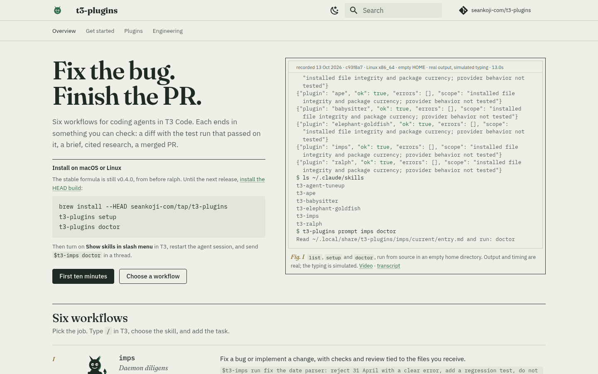
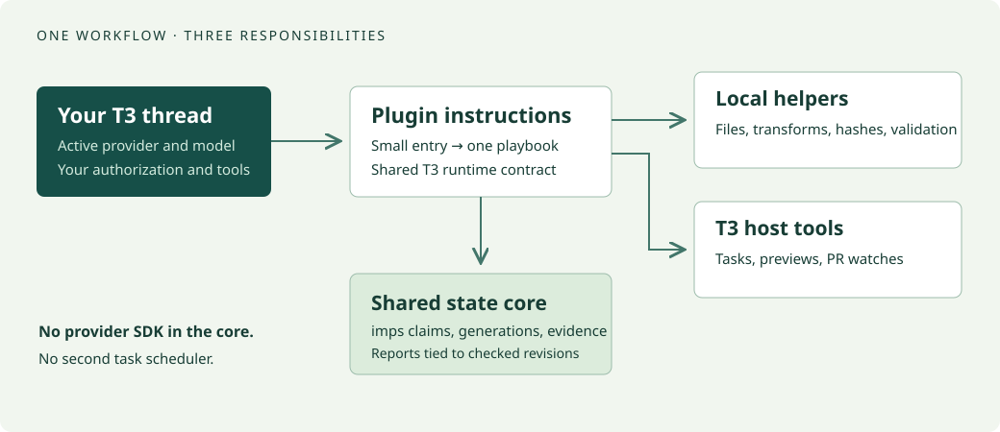

# t3-plugins

**Change the model. Keep the workflow.**

[](https://github.com/seankoji-com/t3-plugins/actions/workflows/test.yml)
[](https://seankoji-com.github.io/t3-plugins/)
[](LICENSE)

Five agent workflows for [T3 Code](https://github.com/pingdotgg/t3code) that run on
whichever provider the thread has selected. Each one is a short entry the agent reads,
plus local tools in the Python standard library for the parts that should be
deterministic. T3 owns child tasks, previews, and PR watches. Nothing is called done
without evidence.

**[Docs](https://seankoji-com.github.io/t3-plugins/)** ·
[Why it is built this way](https://seankoji-com.github.io/t3-plugins/case-study/) ·
[Sightings](https://seankoji-com.github.io/t3-plugins/sightings/) ·
[Contributing](CONTRIBUTING.md)

[](https://seankoji-com.github.io/t3-plugins/)

## Install

```sh
brew install seankoji-com/tap/t3-plugins
t3-plugins setup
t3-plugins doctor
t3-plugins prompt imps doctor
```

Setup installs [slash-menu skill adapters](docs/slash-commands.md); enable the skill
menu in T3 and restart the agent session. Paste the printed prompt when a provider
lacks skill discovery. Install on the machine where your provider
executes tools. [Source installs, upgrades, and rollback](docs/getting-started.md).



## The catalog

| Plate | Plugin | Use it when |
| --- | --- | --- |
| I | [imps](docs/plugins/imps.md) | A bounded change needs a plan, checks at the current revision, and an independent review |
| II | [elephant-goldfish](docs/plugins/elephant-goldfish.md) | You cannot yet state the problem as a task |
| III | [ape](docs/plugins/ape.md) | Another codebase probably solved your gap, and you want cited evidence |
| IV | [babysitter](docs/plugins/babysitter.md) | An authorized PR needs carrying through review, CI, and conflicts |
| V | [agent-tuneup](docs/plugins/agent-tuneup.md) | Your agent settings need an audit that never weakens a permission |

A direct prompt is often enough. Reach for a plugin when its saved artifacts, checks,
or recovery behavior earn their overhead. [Your first workflow](docs/first-workflow.md).

## How it is built



- **Instructions** are Markdown entries under 1,500 words that route to one playbook. Any model with a filesystem can read them.
- **Local tools** use only the Python standard library. Installers, run state, hashes, and audits are plain scripts with tests.
- **Host orchestration** stays with T3. The plugins discover its tools at run time and never ship a scheduler of their own.

imps adds a small evidence gate. It stores checks, requirement artifacts and child
observations, then validates them against the current tree and contract. File edits
invalidate earlier evidence; a local pass never proves a remote outcome.

## What has been observed

Provider-neutral is a design contract, not a claim that every model behaves the same.
The [sightings ledger](https://seankoji-com.github.io/t3-plugins/sightings/) is
generated from `conformance/compatibility.json` and lists per-provider pass counts,
the cases that could not run, and the two defects the live matrix found in the
briefs. Failed attempts are recorded alongside passes.

## Develop

```sh
python3 scripts/run_tests.py          # the unittest suite, modules in parallel
python3 scripts/check_docs.py
```

Python 3.10+, no runtime package installation. Some optional adapters need 3.11+.
The docs site uses a separate pinned [MkDocs build](docs/contributing.md#work-on-the-site)
and is generated from the plugin manifests and the conformance ledger at build time.
See [testing](docs/testing.md) and [contributing](CONTRIBUTING.md).

## Project

Built by [Sean Carey](https://github.com/seankoji). Ported from
[claude-plugins](https://github.com/seankoji-com/claude-plugins); the source revision
and behavioral changes are in the [migration guide](docs/migration.md).
[Security reporting](SECURITY.md) · [MIT license](LICENSE)
