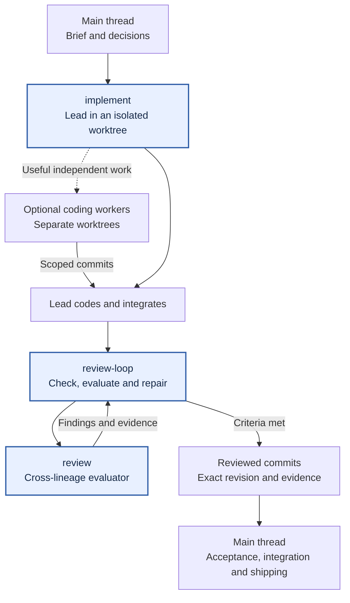

# .agents

[](https://skills.sh/seankoji-com/.agents)

*Give your coding agent a way to finish the job.*

A collection of skills for the work around writing code. Decide what to build,
choose how it should work, get an independent review, and carry a change through
to delivery with evidence that it works.

You describe the outcome. The skills give your agent a repeatable way to work
toward it, and give you a way to see what is decided, what is checked, and what
still needs your attention.

[Find a skill](#find-your-starting-point) · [See an example](#what-it-looks-like-in-practice) · [Get started](#use-the-library) · [All skills](#skill-catalog)

> [!NOTE]
> **Looking for the website?** This README is the public documentation. The
> former GitHub Pages site is retired. Use the
> [repository](https://github.com/seankoji-com/.agents#readme) as your bookmark.

## Why these skills exist

A coding agent can produce a patch while leaving the important work unfinished.
It may solve the wrong problem, make a product decision you wanted to make,
review its own assumptions, or stop while checks are still running.

This library gives those parts of the job names and instructions. You can ask
for a focused interview before building anything. You can get a second opinion
without asking for edits. You can hand over a change for delivery and expect the
agent to track it through review and the repository's release gates.

The aim is to spend your attention on decisions that change the result. Routine
work continues within the scope you gave; consequential unanswered questions
come back to you.

## What is a skill?

A skill is a small written guide that your coding agent reads when it needs to
perform a particular kind of work. Each folder has a `SKILL.md` file with the
purpose, steps, evidence to collect, and conditions for finishing.

The names describe jobs. `interrogate` helps you decide what you mean. `review`
checks work against the goal. `ship` owns delivery. You can use one skill on its
own or combine several in a request.

Your agent host supplies the models, tools, permissions, and any background
workers. This repository supplies their working instructions. There is no
service to start or separate scheduler to run.

## Find your starting point

Choose a skill by the job you want done. Each link opens the instructions your
agent will follow.

[Product and design](#product-and-design) · [Engineering](#engineering) · [Writing and conversation](#writing-and-conversation) · [Agent setup](#agent-setup)

### Product and design

Settle what to build and how people will use it before implementation.

- [interrogate](skills/interrogate/SKILL.md): Turn an idea into a buildable brief through focused questions and a check for unresolved decisions.
- [challenge](skills/challenge/SKILL.md): Get an independent critique of a proposal, a simpler alternative, and evidence that would help you choose. No implementation.
- [choose-design](skills/choose-design/SKILL.md): Compare visual options for a new interface or a material interaction change, then choose before building.
- [design-loop](skills/design-loop/SKILL.md): Research comparable products and autonomously improve the real UI toward a fixed score target, with cross-lineage judges and annotated reports each round.
- [focus-group](skills/focus-group/SKILL.md): Explore a product through fictional participants in a clearly labelled synthetic study. Model responses are not human research.

### Engineering

Build, check, and deliver changes with evidence of what works and what remains.

- [ship](skills/ship/SKILL.md): Carry a change through implementation, checks, independent review, and delivery, with visible progress and a final workflow retrospective.
- [implement](skills/implement/SKILL.md): Move substantial coding into a separate workspace and return reviewed commits to the main conversation for integration. Requires T3 delegation.
- [review](skills/review/SKILL.md): Evaluate a plan, change, or release using an independent model family. Return findings tied to evidence without changing code.
- [review-loop](skills/review-loop/SKILL.md): Hill-climb through repairs and review until the score target and required gates pass or two consecutive rounds fail to improve the best score.
- [test-writer](skills/test-writer/SKILL.md): Choose tests that catch consequential failures, with attention to reliability, maintenance, and CI time.
- [raise-pr](skills/raise-pr/SKILL.md): Prepare PR descriptions and evidence that meet the repository's requirements. Creating or updating the PR needs authority from your request.
- [babysitter](skills/babysitter/SKILL.md): Repair an existing PR, handle checks and review gates, and verify its merge when permitted. Explicit limits such as no-merge still apply.
- [raise-issue](skills/raise-issue/SKILL.md): Prepare and file a bug, feature, or task asynchronously, preserving the evidence and returning a verified issue URL. Requires T3 delegation.

### Writing and conversation

Understand the work and communicate it clearly.

- [github-writing](skills/github-writing/SKILL.md): Credit AI-written GitHub prose with a visible byline naming the actual writer and represented operator.

### Agent setup

Maintain the instructions and configuration your agents depend on.

- [agent-tuneup](skills/agent-tuneup/SKILL.md): Diagnose settings, permissions, connections, or missing skills. Separate saved configuration from observed behavior.

## What it looks like in practice

Suppose you want to add a replay to a browser game. You know the outcome, but
have not decided how replay timing should work.

```text
Add a post-game replay that plays the match in real time.
Use interrogate to settle the timing decisions before implementation.
Keep the game's existing visual style.
```

The interview should resolve questions that change the implementation. Does
pausing the replay pause the whole game? What happens if someone leaves? It
should use facts already available in the project and reuse decisions you have
made.

If the replay needs a new control that the existing design does not answer,
`choose-design` can help you choose it. If the current interface already gives
a clear answer, the agent can preserve it and continue.

For delivery, you can be explicit about the endpoint:

```text
Ship the agreed replay. Verify playback in the browser, get an independent
review, and take it through the repository's checks and merge gates.
```

You should receive the result and its evidence, with any unfinished work named.
A passing local test, a merged PR, and a working production replay are separate
claims. Each needs its own verification.

You can also keep the job narrow:

```text
Challenge this replay proposal. Return findings without editing code.
```

That request ends with an evaluation. It does not start implementation.

## What you stay in control of

Skills carry different scopes. Read the linked instructions before handing over
a job, especially one that can publish or merge changes.

- **Decisions.** The agent asks about missing choices that could materially
  change the next step. Settled choices stay settled unless new evidence affects them.
- **Authority.** `ship` and `babysitter` include scoped commits, pushes, and
  merges through repository protections. Explicit limits in your request still apply.
  `ship` also permits rebasing its own PR branch with `--force-with-lease`, filing
  deferred-bug issues, and proposing workflow improvements as issues in your
  explicitly configured skill repository. These skills do not bypass protections.
- **Sharing.** Invoking `choose-design` permits sending the minimal design
  brief to the selected providers, subject to your sharing limits. Broader raw-file
  sharing needs separate authority.
- **Review.** Independent review uses a different model family from the
  coordinator and material authors. Additional loop judges may share a lineage
  when their verified reasoning level is higher than every material implementor's.
- **Evidence.** The agent reports checks against the revision it actually tested.
  Missing access, unavailable reviewers, and unverified behavior remain visible gaps.
- **Follow-through.** Confirmed bugs deliberately left unfixed need tracking.
  The workflow records what remains rather than treating a passing check as the end.

These are instructions for agents to follow. The library's own tests check its
structure and helper behavior; they do not establish how reliably a live model
will follow every instruction or prove a cost or quality advantage.

## Use the library

Pick the skills you need. You can install one or more through
[skills.sh](https://skills.sh/seankoji-com/.agents) without adopting this owner's
whole setup. Run this from your project and choose the skills and agents:

```sh
npx skills add seankoji-com/.agents
```

Or select a single skill:

```sh
npx skills add seankoji-com/.agents --skill interrogate
```

The [Skills CLI](https://github.com/vercel-labs/skills#install-a-skill) requires
Node.js 22.20 or later. Workflow skills can reference other skills in this
library; install their supporting skills too. Installation does not supply the
host capabilities described below.

### Use an installed skill

Invoke a skill using the convention your host supports, such as its name in a
request or a slash command. Start with a bounded job:

```text
Use review to evaluate this implementation against the brief. Do not edit files.
```

`focus-group` disables automatic model invocation.
Use your host's explicit skill invocation, such as `/focus-group`
where slash commands are supported.

### Work from a clone

To edit the skills or maintain your own copy, clone the repository:

```sh
git clone https://github.com/seankoji-com/.agents.git
```

Point your host's native skill discovery at the clone's `skills` directory,
using that host's configuration. Keep the directory together because skills
link to sibling skills and references. You can read every skill directly on
GitHub before configuring discovery.

### Host requirements

The library is written for **T3 Code and Codex**. Other hosts can use skills whose
required capabilities they provide. Isolated `implement` and asynchronous
`raise-issue` require T3 delegation. Follow each skill's own fallback when a
required capability is missing. Inline issue work requires an explicit request.

Reading the instructions needs no running service. Python helpers require Python
3.10+ and the standard library. Owner host-delivery configuration is only for
maintaining this repository, not for using skills from a clone.

Older releases through v0.13.2 contain archives from the previous package.
Use the current `skills` tree for the library described here.

## Other skills I use

These skills come from [pstack](https://github.com/cursor/plugins/tree/main/pstack).
Install them from upstream rather than from this repository:

- [bro](https://github.com/cursor/plugins/blob/main/pstack/skills/bro/SKILL.md): Restate the last answer in plain language.
- [unslop](https://github.com/cursor/plugins/blob/main/pstack/skills/unslop/SKILL.md): Remove formulaic AI phrasing from writing.
- [ketchup](https://github.com/cursor/plugins/blob/main/pstack/skills/ketchup/SKILL.md): Catch up on changes in a conversation and decisions waiting on you.

```sh
npx skills add cursor/plugins --skill bro unslop ketchup --global
```

These require explicit invocation on hosts that respect
`disable-model-invocation`, such as `/bro`, `/unslop` or `/ketchup` where supported.

For writing skills and agent instructions, install
[writing-for-agents](https://github.com/mattpocock/skills/tree/main/skills/productivity/writing-for-agents)
from Matt Pocock's library. It replaces this repository's former `agent-docs` skill
and keeps its upstream name:

```sh
npx skills add mattpocock/skills --skill writing-for-agents --global
```

This library maintains its own versions of several workflow skills inspired by
other libraries. They remain here because their instructions differ from
upstream. Third-party installations are local state, excluded from the generated
catalog and from Git. The owner checkout ignores the installed `bro`, `unslop`,
`ketchup` and `writing-for-agents` folders and the Skills CLI's global lock file.
A fresh checkout does not install these optional skills automatically.

## How the workflows fit together

Use the skills that help with the current task. You do not need to run the whole
library for every change. The guide below explains the handoffs, review rules,
issue tracking, and T3-specific details.

<details>
<summary><strong>Workflow guide</strong> · decisions, implementation, review, and delivery</summary>

### Start with the outcome

The [replay example above](#what-it-looks-like-in-practice) gives the agent an
outcome. It can choose the skills that help, reuse decisions already made and
skip unnecessary ceremony. This diagram shows how a delivery request can proceed.


Blue boxes name skills; other boxes show steps or outcomes. Dashed branches are
conditional choices. They are not a required sequence or an
executable router. The skills are instructions the agent selects for the task.
This example follows a repository that uses PRs; a repository with a direct
publication policy keeps its prescribed delivery path.

**Settle the consequential choices.** [interrogate](skills/interrogate/SKILL.md) asks
about uncertainty that could change the next implementation step. It obtains
a cross-lineage readiness review before handing off. For unresolved visual or
interaction choices, [choose-design](skills/choose-design/SKILL.md) presents
mockups after product decisions are settled. The user chooses before UI work
begins. It defaults to two designer lineages, or three for a new screen, app or
unconstrained redesign. A missing lineage leaves the comparison incomplete
unless the user accepts a smaller set. An established design that answers the
question needs no new selection. Layout and minor edits preserve the existing
design and compare only the unresolved change. Reports give key decisions
stable feature IDs and keep options visible in separate frames. Controls must
work in the presentation host or show labelled static states. Invoking the
chooser authorises sharing its minimal design brief with the selected providers,
subject to standing limits.
Delegates receive that authority source. Broader raw-file sharing and host
approvals remain separate gates.

**Bring evidence to the review.** [review-loop](skills/review-loop/SKILL.md)
uses [review](skills/review/SKILL.md) for independent evaluation, evidence,
severity and finding dispositions. Visible changes need observed UI evidence.
For work headed to a PR, [raise-pr](skills/raise-pr/SKILL.md) applies early enough
to capture practical mobile and desktop before screenshots. Its placement near
the end of the diagram represents PR preparation, not its first invocation.

For autonomous design iteration, [design-loop](skills/design-loop/SKILL.md) adds
reference research, a fixed design rubric and required measurable checks. Its
rubric covers task value, clarity, efficiency, control, visual craft, emotional
appeal and brand fit. Choose product-specific anchors and justify weight changes
from the scoped user outcome and intended emotional response before scoring.
Select the implementor, primary judge, extra judges and target at setup. No round cap
or other ceiling is required; explicit user limits still apply.
Every judge must directly view and interact with the candidate. The primary's
baseline evaluation verifies access before scoring against the frozen rubric.
Additional judges' access pilots launch concurrently and may overlap the baseline;
all routes must pass before implementation or panel entry, with isolated sessions
where possible.
While pilots run, the coordinator researches references, captures the baseline,
runs independent checks and prepares the rubric, briefs and evidence storage.
Panel judges also run concurrently where sessions and data can be isolated.
During scoring, the candidate stays frozen while the coordinator organizes
evidence, prepares reports and drafts repair options. Work waits only on actual
dependencies or shared resources that would interfere.
The primary judge evaluates first, then the whole eligible
panel must pass the same candidate. Model scores remain judgments, separate from
measured checks and human research.

Each change round produces an HTML report with annotated before/after screenshots,
reasons, scores and evidence gaps. Two consecutive rounds without exceeding the
phase's best score stop the run. The panel uses its lowest judge score, and the
explicit user limits apply across both phases. A stopped run with changed code targets
a draft product PR marked `GOAL NOT MET`, subject to independent code review and
the repository's delivery policy. No-change runs return their reports without an
empty PR. Unavailable code review blocks PR creation unless explicitly waived
under `raise-pr`; explicit limits that prevent endpoint work also remain a blocker.
`review-loop` uses the same target-or-two-round-stagnation stopping rule while
retaining finding dispositions and release gates. `choose-design` keeps its
operator-selected options.

Before any design-loop run concludes, reconcile identified bugs against the final
revision. Invoking the skill authorises filing confirmed bugs left unfixed in the
task's repository, subject to explicit no-post limits. Reuse matching issues under
the deferred-bug procedure and return verified issue URLs. Pending or blocked
filing leaves tracking incomplete, even if the design target passes.

Review limits trigger a [progress diagnosis](skills/review/references/budget-exhaustion.md),
not an automatic request for more rounds. The coordinator checks whether repairs
are converging, stalled or cycling and recommends a concrete alternative, such
as a targeted reproduction, a different repair or a smaller proposed delivery.
Every extension request includes the original allowance or stopping rule, prior
user-approved and automatic extensions, total consumption and proposed addition.
It explains why the limit was reached, what changes next, realistic finishing
prospects, an alternative and a stop condition. Unknown history stays explicit.
Without a justified changed approach, further review stays on hold while useful
independent work continues. Existing review gates and the user's scope still apply.

For PR maintenance, `babysitter` supplies the actors needed to finish: its
coordinator can obtain independent reviewers and delegate isolated repairs or
tests. Children return results without creating more agents or watches. A
three-attempt review budget permits one diagnosed extension of up to two attempts
when a changed approach can produce new evidence; stricter caller limits win.

**Finish the authorised endpoint.** [ship](skills/ship/SKILL.md) carries the
change through checks, review and merge. [babysitter](skills/babysitter/SKILL.md)
handles current-head CI and review gates. A merge is evidence of a merge;
deployment and live acceptance need their own verification and authority.
Required human approvals and repository protections remain merge gates.

Babysitting resumes from an owned record of unfinished feedback, reviewed
revision, next action and confirmed native watch. The coordinator repairs,
supplies fresh review, attempts the permitted merge as soon as gates pass and
reads back GitHub's merged state. Green checks, queue enrollment, auto-merge
and a completed repair pass remain intermediate. Older unresolved feedback
survives a push or interruption. Its
[continuation guide](skills/babysitter/references/continuation.md) defines recovery,
bounded retries and lifecycle acceptance scenarios. Those scenarios are a
verification plan, not evidence of a live successful run.

AI-written GitHub passages open with a visible byline. [github-writing](skills/github-writing/SKILL.md)
credits the model that drafted an issue, PR description, comment, review,
discussion or release note, even when another agent posts it:

```markdown
> [!NOTE]
> _Written by **GPT-6.1 Sol** on behalf of @seankoji_
```

The model and handle reflect the actual writer and represented operator.
Existing human text, code-author credits and reviewer disclosures remain
distinct. Commit attribution keeps its existing policy; the byline contains no
private session links.

### Keep implementation off the main thread

Use [implement](skills/implement/SKILL.md) when moving substantial coding into a
T3 delegate is worth the coordination cost. Its working lead codes directly and
delegates substantial independent parts when useful. Each coding worker has
its own prepared worktree and a non-overlapping scope.



Model selection inside `implement` aims for the lowest expected total cost that
meets the quality bar, including review, retries and repairs. A cheaper first
attempt is useful only if it can do the job. One evidenced model or effort
upgrade is allowed across the task; it does not reset scores or stagnation counters.
If a material product or design decision emerges, the lead returns it to the
main thread and continues only independent work.

Independent review must use a lineage different from the coordinator and every
material model author for the primary review. Additional loop judges may share
a lineage when their verified reasoning level is strictly higher than every
material implementor's. Required independent code review keeps its lineage gate.
Outside `implement`, the default preference order lives in
[review](skills/review/SKILL.md). Named reviewer choices still have to be eligible.
The main thread can reuse an eligible completed review at the handoff. Integration
changes or a moved base require reassessing the affected evidence and review.
No measured cost or quality advantage is claimed by these instructions alone.

### Let non-blocking issue filing run alongside shipping

Every confirmed bug intentionally left unfixed needs a verified issue URL before
the execution workflow is complete. That includes minor SEV3 bugs. Rejected
findings and style preferences do not need issues, and filing does not lower
severity or waive a release blocker.

[raise-issue](skills/raise-issue/SKILL.md) prepares and files bugs, features and
tasks in owned, organisation and upstream repositories. It uses an asynchronous
T3 issue writer and reuses validated evidence. The top-level workflow owner
owns the job; child delegates return filing packets to that owner.


The delivery endpoint and verified tracking for every deferred bug must both
finish before the final retrospective. A pending task handle is not an issue URL. The shared
[deferred-bug procedure](skills/review/references/deferred-bugs.md) owns the
details, including deduplication and evidence preservation.

Async dispatch follows the host's continuation rules. When T3 requires the main
agent to yield, hosted checks can continue, but the main agent does not keep
executing. For an otherwise-ready merge, it may merge first and dispatch filing
immediately afterward. The owner keeps tracking active until the URLs are verified.

### Make progress visible and learn from the run

`ship` owns the operator-visible task list in the parent context. It discovers
the native plan/todo tool, or a T3 MCP API that writes the same parent panel,
and records work, owners, dependencies, evidence and status there. It updates
the same list through handoffs and resumes. If neither tool is available, it
reports the gap and posts a concise parent-message status list at each phase change.
Delegate jobs and scheduled work are not substitutes for checklist items.

The last stage reads the ship invocation's operational activity across the
parent and every owned delegate, including descendants, failed attempts, reviews
and issue writers. The [retrospective procedure](skills/ship/references/retrospective.md)
defines the execution boundary, pagination, coverage record and bounded cutoff.
Missing logs remain an explicit gap; a summary alone is not full log coverage.

Supported amendments are pitched through `raise-issue` in the operator's
configured skill repository. For this owner that is `seankoji-com/.agents`.
Users of a clone or fork must explicitly name or configure their destination
before anything is posted; cloning this library grants no consent to publish
their project evidence in this owner's tracker.
Each needs redacted execution evidence, a broadly useful proposed rule, tradeoffs
and a validation case. The retrospective does not automatically change skills,
publish transcripts or manufacture proposals to meet a quota. Shipping ends
when the retrospective and any proposal issue URLs are verified, or with an
evidenced no-change result. Blocked stages stay visible in the task list.

### T3 permission compatibility

The shared [dispatch preflight](skills/agent-tuneup/references/t3-dispatch.md)
records an owner-reported T3 workaround. OpenCode, Grok and Muse must start with
explicit `full-access` for unattended work while their `auto` route falls back
to `ask`. T3 does not allow a child to exceed its parent's permissions, so a
parent in `auto`, including Codex/ChatGPT, cannot create those full-access delegates. Skills
filter incompatible routes before launch and preserve named-model constraints.

Codex/ChatGPT in full access may instead encounter an approval route mapped to
`never`. Operator questions use supported input tools; an impossible tool approval
is reported as a blocker. The workaround does not authorise changing global
permissions, bypassing host policy or silently switching a named model.

</details>

## Skill catalog

The complete index below uses each skill's own metadata. Use the grouped list above
for a human introduction, or open a skill here to read its exact instructions.

<!-- skill-catalog:start -->

| Skill | When to use it |
| --- | --- |
| [agent-tuneup](skills/agent-tuneup/SKILL.md) | Use when the user asks to audit, troubleshoot or change agent configuration, permissions, MCP connections or native skill discovery. |
| [babysitter](skills/babysitter/SKILL.md) | Autonomously repair requested pull requests through verified merge. Use when asked to babysit, watch or monitor PRs; honour explicit read-only and no-merge limits. |
| [challenge](skills/challenge/SKILL.md) | Pressure-test an idea, design or proposal with an independent cross-lineage reviewer. Use when the user asks for an adversarial second opinion or to challenge assumptions; return findings without implementation. |
| [choose-design](skills/choose-design/SKILL.md) | Use after product decisions are settled for new UI, requested redesigns or material unresolved visual or interaction choices. For existing UI, preserve its design and limit choices to the requested change; routine edits need no chooser. |
| [design-loop](skills/design-loop/SKILL.md) | Improve a product's UI through reference research, direct interaction and scored cross-lineage judging, with annotated HTML reports each round and a final PR. Use for autonomous design iteration toward a score target, rather than operator-selected mockup options. |
| [focus-group](skills/focus-group/SKILL.md) | Use when the user requests a synthetic focus group or persona-based product evaluation, including planning, running or reviewing the study. |
| [github-writing](skills/github-writing/SKILL.md) | Use whenever drafting or editing LLM-written GitHub issues, pull requests, comments, reviews, discussions or release notes on the user's behalf. |
| [implement](skills/implement/SKILL.md) | Use when the user invokes implement or requests implementation through T3 delegates, returning reviewed commits for the main thread to integrate and ship. |
| [interrogate](skills/interrogate/SKILL.md) | Stress-test a plan, decision or idea through questions. Use when the user asks to interrogate a plan or wants an interview to clarify their thinking. |
| [raise-issue](skills/raise-issue/SKILL.md) | Use when the user or an authorised workflow asks to investigate, prepare, file or follow up on a bug, feature or task issue in an owned, organisation or external repository, using an asynchronous T3 delegate. |
| [raise-pr](skills/raise-pr/SKILL.md) | Use whenever creating or updating a pull request, including during implementation, review-loop, ship and PR maintenance. |
| [review](skills/review/SKILL.md) | Use for independent cross-lineage reviews of plans, code, UI, backend and releases, including review-loop participants and interrogate's stop-condition check. |
| [review-loop](skills/review-loop/SKILL.md) | Use when the user requests an iterative implementation, independent review and repair loop, or invokes review-loop to carry a goal to an agreed endpoint. |
| [ship](skills/ship/SKILL.md) | Use when the user explicitly asks to ship a change through delivery, visible progress tracking and a final workflow retrospective. |
| [test-writer](skills/test-writer/SKILL.md) | Use when writing or reviewing tests, choosing regression coverage, or assessing test value, reliability and CI runtime. |

<!-- skill-catalog:end -->

## Maintaining this library

The instructions below are for people changing or publishing this repository.
They cover documentation checks and the owner's direct-publication workflow.

<details>
<summary><strong>Contributor and owner guide</strong> · checks, publication, and host delivery</summary>

### Documentation that tracks the code

```sh
python3 -B scripts/check_library.py
python3 -B -m unittest discover -s tests -v
```

The same checks run in CI and before owner publication. They enforce:

- Every registered skill appears exactly once in the generated catalog, with
  its current description. New source skills must be registered.
- Local Markdown links resolve, and annotated Mermaid skill nodes name real skills.
- Changes to skill instructions or their Markdown references invalidate the
  README's review receipt, requiring another look at the prose and diagrams.
- Skill metadata, entry-point budgets, helper imports and relocation contracts
  continue to pass the existing library checks.

After reviewing the README against changed instructions, refresh it with:

```sh
python3 -B scripts/check_library.py --update-readme --acknowledge-docs
```

The command regenerates the catalog and records the current instruction digest.
It preserves the hand-written prose and diagrams. A review receipt records an
acknowledgement; it cannot prove that a human or model checked every claim.
Tests do not establish Mermaid rendering, live model behaviour, installed skill
discovery or deployment success. Those need separate evidence.

People changing the library should also read [AGENTS.md](AGENTS.md).

<!-- skills-review: 89d2ce67e59df05f5a851d6952e4b74291dd817928b9638e4ab48d25624ae02d -->

### Owner maintenance

This repository publishes by fast-forward updates to `main`; it does not use PRs
for its own maintenance. That repository policy is separate from the PR workflow
the skills support in other projects.

These commands are for the repository owner. Using the skills from a clone does
not require host-delivery configuration.

#### Configure host delivery

Copy [.env.example](.env.example) to `.env` in the repository root, then replace
its synthetic destinations with SSH aliases or `user@host` destinations you control:

```sh
cp .env.example .env
```

Set `MAINTAIN_SYNC_HOSTS` to a whitespace-separated list. The loader reads this
setting from the file, not from shell environment variables. Real destinations
belong only in the local `.env`. Files matching `.env*`, including local variants
and editor backups, are ignored; `.env.example` is the sole checked-in exception.
Keep that example generic.

Each receiver keeps its source checkout at `~/.agents` and its discovery refresh script at
`~/.dotfiles/scripts/t3-workflow-skills.py`. Configure SSH keys, ports and jump
hosts through your SSH configuration. The receiving checkout must be clean, on
`main` and use the same origin as the publishing checkout.

`maintain.py` reads `.env` beside the script's repository, regardless of the
working directory. It accepts UTF-8 with or without a byte-order mark, quoted
values, comments beginning after whitespace and an optional `export` prefix for
`MAINTAIN_SYNC_HOSTS`. It does not execute shell code, expand variables
or export settings to subprocesses. Other settings are ignored. Missing, empty,
invalid or duplicate destinations stop publication before commits or pushes.
Validation and commit hooks need no local host configuration.

#### Publish and retry delivery

```sh
python3 scripts/maintain.py check  # validate only
python3 scripts/maintain.py        # validate, commit, push and deliver to configured hosts
python3 scripts/maintain.py sync   # retry configured host delivery
```

The publication command stages current changes, obtains a commit message from
the local Codex CLI and pushes `main`. It then updates the owner's configured
checkouts with fast-forward updates, runs their tests and refreshes skill
discovery. It stops publication on failed local checks, a changing working tree
or a rejected push. A dirty receiver is left untouched, and delivery continues
to the other configured destinations. A partial delivery reports failure while
preserving the source commit, successful push and completed receiver updates.
Fix the reported receiver problem, then use `maintain.py sync` to retry delivery
without generating another commit.

#### One-time external skill migration on receivers

Older checkouts track `bro`, `unslop`, `ketchup` or `agent-docs`. Updating removes
those tracked files, even if you installed identical upstream copies beforehand.
The upstream replacement for `agent-docs` is named `writing-for-agents`. Sync detects
this transition and leaves that receiver's checkout untouched. Migrate each
affected receiver once, then retry delivery from the publishing checkout.

On a clean receiver checkout on `main` with the expected origin, first check
that the Skills CLI is available. Then update and immediately reinstall the upstream
skills before refreshing discovery:

```sh
cd ~/.agents
npx skills --version
git pull --ff-only origin main
npx skills add cursor/plugins --skill bro unslop ketchup --global --agent codex --yes
npx skills add mattpocock/skills --skill writing-for-agents --global --agent codex --yes
python3 scripts/check_library.py
python3 ~/.dotfiles/scripts/t3-workflow-skills.py install
python3 ~/.dotfiles/scripts/t3-workflow-skills.py check
```

Run the update and reinstall while no agent is using those skills. If the
installation fails, keep that receiver out of use and rerun the installation
before refreshing discovery. Sync does not install third-party skills or change
provider settings automatically. A sync run can update other receivers while
reporting this receiver's migration hold.

In T3, the Publish action in `t3.json` runs the same owner workflow and requires
the same local `.env` setup. It does not supply destinations or bypass checks.
Organisation workflows remain in place. Publishing, receiver tests, discovery
refresh and fresh-session acceptance are separate results.

#### Keep maintenance logs local

For a worktree-owned log, pass `--log-file` with a new path in an existing ignored
directory. The helper creates the file with owner-only permissions and refuses
to overwrite an existing file. Without this option it uses the system temporary
directory.

Local MCP settings, synced skill copies, marketplace state and machine wiring
are ignored. Keep them out of the public source; do not force-add ignored paths.

</details>

## License and security

[MIT licensed](LICENSE). Report vulnerabilities through the repository's
[private advisory form](https://github.com/seankoji-com/.agents/security/advisories/new).
If it is unavailable, follow the
[organisation security policy](https://github.com/seankoji-com/.github/blob/main/SECURITY.md).
Keep secrets and private logs out of public reports.
