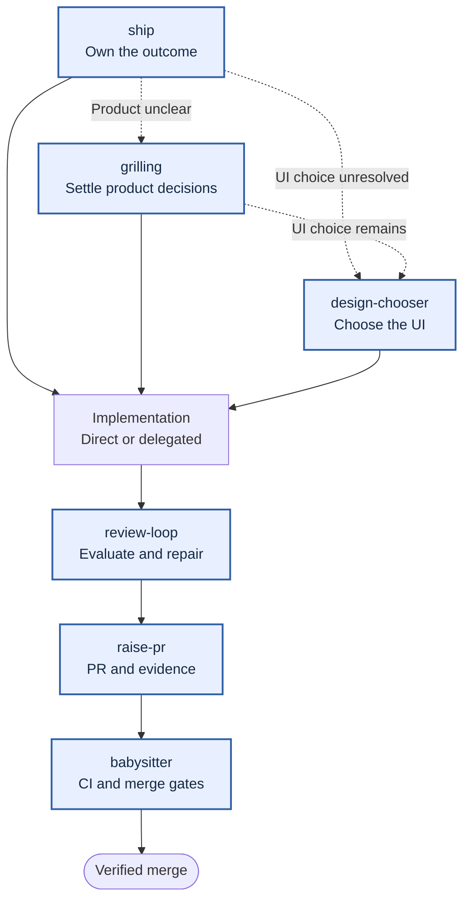
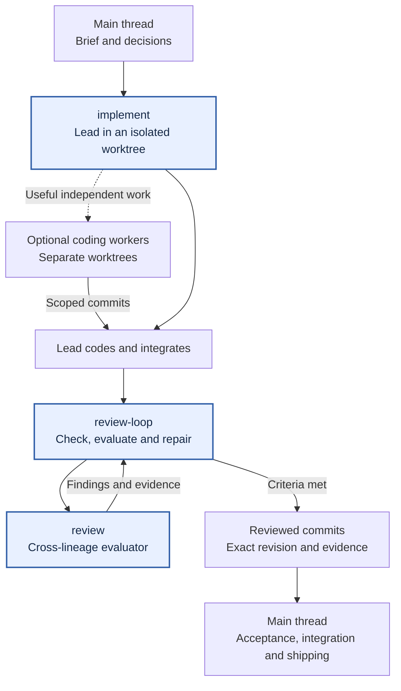
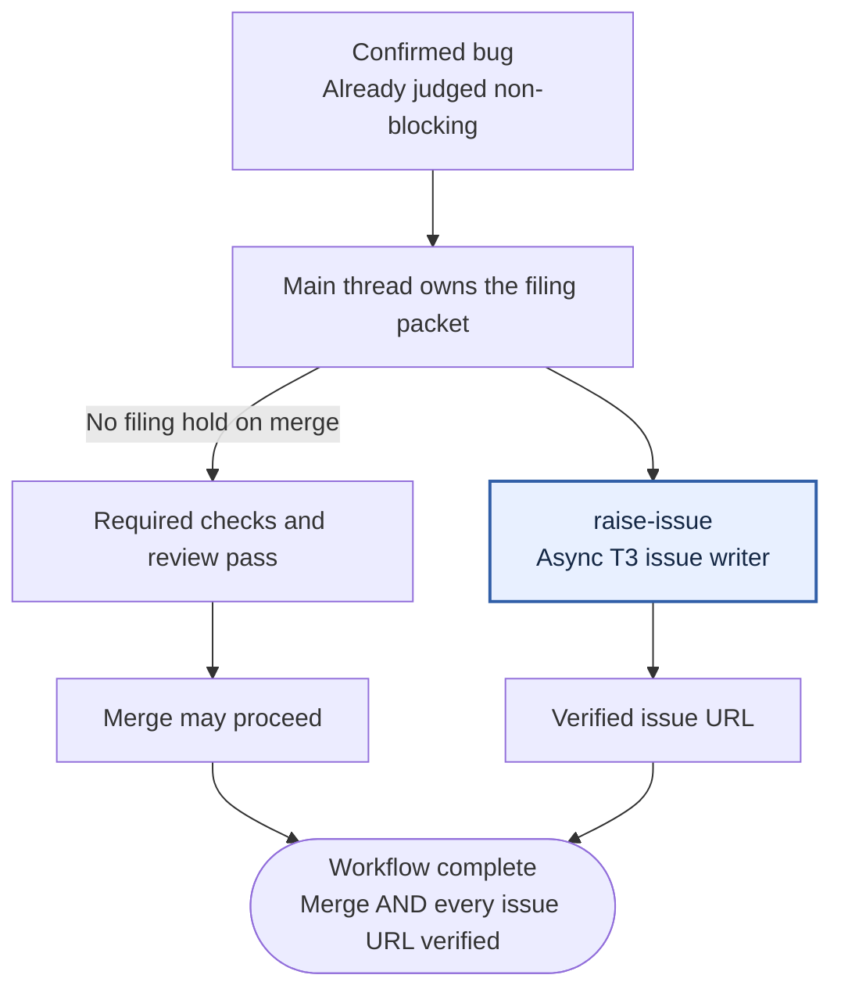

# .agents

A personal skill library for taking coding agents from an idea to a reviewed,
merged change.

The interesting part of agent-assisted development is deciding what deserves a
question, what can run independently, and what evidence is enough to ship.
This library makes those decisions explicit. Product interviews, UI choices,
isolated implementation, independent review and issue tracking each have a
small, readable skill with a clear handoff.

The main thread keeps the goal and owns the result. Delegates receive bounded
jobs. Review comes from a different model family. Confirmed bugs left for later
get tracking issues, even when they do not block the release.

[Explore the skills](#skill-catalog) · [Try it](#use-the-library) · [Keep docs current](#documentation-that-tracks-the-code)

## Start with the outcome

```text
Ship a post-game replay for typing.football that plays the match in real time.
Grill me on unresolved product decisions and help me choose the UI.
```

That request gives the agent an outcome. It can choose the skills that help,
reuse decisions already made and skip unnecessary ceremony.



Blue boxes name skills; other boxes show steps or outcomes. Dashed branches are
conditional choices. They are not a required sequence or an
executable router. The skills are instructions the agent selects for the task.
This example follows a repository that uses PRs; a repository with a direct
publication policy keeps its prescribed delivery path.

**Settle the consequential choices.** [grilling](skills/grilling/SKILL.md) asks
about uncertainty that could change the next implementation step. It obtains
a cross-lineage readiness review before handing off. For unresolved visual or
interaction choices, [design-chooser](skills/design-chooser/SKILL.md) presents
mockups after product decisions are settled. The user chooses before UI work
begins. An established design that answers the question needs no new selection.

**Bring evidence to the review.** [review-loop](skills/review-loop/SKILL.md)
uses [review](skills/review/SKILL.md) for independent evaluation, evidence,
severity and finding dispositions. Visible changes need observed UI evidence.
For work headed to a PR, [raise-pr](skills/raise-pr/SKILL.md) applies early enough
to capture practical mobile and desktop before screenshots. Its placement near
the end of the diagram represents PR preparation, not its first invocation.

**Finish the authorised endpoint.** [ship](skills/ship/SKILL.md) carries the
change through checks, review and merge. [babysitter](skills/babysitter/SKILL.md)
handles current-head CI and review gates. A merge is evidence of a merge;
deployment and live acceptance need their own verification and authority.
Required human approvals and repository protections remain merge gates.

## Keep implementation off the main thread

Use [implement](skills/implement/SKILL.md) when moving substantial coding into a
T3 delegate is worth the coordination cost. Its working lead codes directly and
delegates substantial independent parts when useful. Each coding worker has
its own prepared worktree and a non-overlapping scope.



Model selection inside `implement` aims for the lowest expected total cost that
meets the quality bar, including review, retries and repairs. A cheaper first
attempt is useful only if it can do the job. One evidenced model or effort
upgrade is allowed across the task; it does not reset the review budget.
If a material product or design decision emerges, the lead returns it to the
main thread and continues only independent work.

Independent review must use a lineage different from the coordinator and every
material model author. A different version of the same family does not count.
Outside `implement`, the default preference order lives in
[review](skills/review/SKILL.md). Named reviewer choices still have to be eligible.
The main thread can reuse an eligible completed review at the handoff. Integration
changes or a moved base require reassessing the affected evidence and review.
No measured cost or quality advantage is claimed by these instructions alone.

## Let non-blocking issue filing run alongside shipping

Every confirmed bug intentionally left unfixed needs a verified issue URL before
the execution workflow is complete. That includes minor SEV3 bugs. Rejected
findings and style preferences do not need issues, and filing does not lower
severity or waive a release blocker.

[raise-issue](skills/raise-issue/SKILL.md) prepares and files bugs, features and
tasks in owned, organisation and upstream repositories. It uses an asynchronous
T3 issue writer and reuses validated evidence. The top-level workflow owner
owns the job; child delegates return filing packets to that owner.



Completion needs both the delivery endpoint and verified tracking for every
deferred bug. A pending task handle is not an issue URL. The shared
[deferred-bug procedure](skills/review/references/deferred-bugs.md) owns the
details, including deduplication and evidence preservation.

Async dispatch follows the host's continuation rules. When T3 requires the main
agent to yield, hosted checks can continue, but the main agent does not keep
executing. For an otherwise-ready merge, it may merge first and dispatch filing
immediately afterward. The owner keeps tracking active until the URLs are verified.

## Use the library

```sh
git clone https://github.com/seankoji-com/.agents.git
```

Point your host's native skill discovery at the clone's `skills` directory.
Keep that directory together: skills link to shared review rules and sibling
skills. Invoke a skill using the naming convention your host supports, such as
a slash command or its name in a request.

```text
Use grilling to help me settle how replay timing should work.
Use review to independently evaluate this implementation against the brief.
Ship this change through tests, review and merge.
```

Each skill is a folder with a `SKILL.md` entry point. Supporting references,
templates and helpers stay inside that folder. There is no install step to read
the instructions; Python helpers require Python 3.10+ and the standard library.

The library is written for T3 Code and Codex. Other hosts can use skills whose
required capabilities they provide. Isolated `implement` and asynchronous
`raise-issue` require T3 delegation. A missing route is reported as a blocker;
inline issue work requires an explicit request. Follow each skill's own fallback.

Read authority-bearing skills before invoking them. `ship` and `babysitter`
include scoped commits, pushes and protected merges. `implement` returns local
commits for the main thread to integrate. Explicit narrower limits always apply.
None of these grants permission to bypass repository protections.

Older releases through v0.13.2 contain archives from the previous package.
Use the current `skills` tree for the library described here.

## Skill catalog

Descriptions below come directly from each skill's metadata.

<!-- skill-catalog:start -->

| Skill | When to use it |
| --- | --- |
| [agent-docs](skills/agent-docs/SKILL.md) | Use when creating, editing or auditing a skill, AGENTS.md, CLAUDE.md or a doc they point to. |
| [agent-tuneup](skills/agent-tuneup/SKILL.md) | Use when the user asks to audit, troubleshoot or change agent configuration, permissions, MCP connections or native skill discovery. |
| [babysitter](skills/babysitter/SKILL.md) | Repair and merge requested pull requests. Use when asked to babysit, watch or monitor PRs, and honour explicit read-only and no-merge limits. |
| [bro](skills/bro/SKILL.md) | Restate the last message in plain human language, with no jargon. |
| [challenge](skills/challenge/SKILL.md) | Pressure-test an idea, design or proposal with an independent cross-lineage reviewer. Use when the user asks for an adversarial second opinion or to challenge assumptions; return findings without implementation. |
| [design-chooser](skills/design-chooser/SKILL.md) | Use after product decisions are sufficiently settled and before implementing UI work that leaves a material visual or interaction choice unresolved. |
| [focus-group](skills/focus-group/SKILL.md) | Use when the user requests a synthetic focus group or persona-based product evaluation, including planning, running or reviewing the study. |
| [grilling](skills/grilling/SKILL.md) | Stress-test a plan, decision or idea through questions. Use when the user asks to be grilled or wants an interview to clarify their thinking. |
| [implement](skills/implement/SKILL.md) | Use when the user invokes implement or requests implementation through T3 delegates, returning reviewed commits for the main thread to integrate and ship. |
| [ketchup](skills/ketchup/SKILL.md) | Catch the user up on changes in this chat and every decision still waiting on them. Use for /ketchup. |
| [raise-issue](skills/raise-issue/SKILL.md) | Use when the user or an authorised workflow asks to investigate, prepare, file or follow up on a bug, feature or task issue in an owned, organisation or external repository, using an asynchronous T3 delegate. |
| [raise-pr](skills/raise-pr/SKILL.md) | Use whenever creating or updating a pull request, including during implementation, review-loop, ship and PR maintenance. |
| [review](skills/review/SKILL.md) | Use for independent cross-lineage reviews of plans, code, UI, backend and releases, including review-loop participants and grilling's stop-condition check. |
| [review-loop](skills/review-loop/SKILL.md) | Use when the user requests an iterative implementation, independent review and repair loop, or invokes review-loop to carry a goal to an agreed endpoint. |
| [ship](skills/ship/SKILL.md) | Use when the user explicitly asks to ship a change through tests, review and merge. |
| [test-writer](skills/test-writer/SKILL.md) | Use when writing or reviewing tests, choosing regression coverage, or assessing test value, reliability and CI runtime. |
| [unslop](skills/unslop/SKILL.md) | Cut AI tells from any writing. |

<!-- skill-catalog:end -->

## Documentation that tracks the code

```sh
python3 -B scripts/check_library.py
python3 -B -m unittest discover -s tests -v
```

The same checks run in CI and before owner publication. They enforce:

- Every registered skill appears exactly once in the generated catalog, with
  its current description. New source skills must be registered.
- Local Markdown links resolve, and annotated Mermaid skill nodes name real skills.
- Changes to skill instructions or their Markdown references invalidate the
  README's review receipt, requiring another look at the prose and diagrams.
- Skill metadata, entry-point budgets, helper imports and relocation contracts
  continue to pass the existing library checks.

After reviewing the README against changed instructions, refresh it with:

```sh
python3 -B scripts/check_library.py --update-readme --acknowledge-docs
```

The command regenerates the catalog and records the current instruction digest.
It preserves the hand-written prose and diagrams. A review receipt records an
acknowledgement; it cannot prove that a human or model checked every claim.
Tests do not establish Mermaid rendering, live model behaviour, installed skill
discovery or deployment success. Those need separate evidence.

People changing the library should also read [AGENTS.md](AGENTS.md).

<!-- skills-review: 890c293b8f100a6ef341a26759a450393d2361c149f0425a8be26a5e8d406f6e -->

## Owner maintenance

This repository publishes by fast-forward updates to `main`; it does not use PRs
for its own maintenance. That repository policy is separate from the PR workflow
the skills support in other projects.

The following commands are for the repository owner, not a fork or fresh clone:

```sh
python3 scripts/maintain.py check  # validate only
python3 scripts/maintain.py        # validate, commit, push and deliver to configured hosts
python3 scripts/maintain.py sync   # retry configured host delivery
```

The publication command stages current changes, obtains a commit message from
the local Codex CLI and pushes `main`. It then updates the owner's configured
checkouts. It stops on failed checks, a changing working tree, a rejected push
or a dirty receiving checkout. In T3, the Publish action in `t3.json` runs the
same owner workflow. Organisation workflows remain in place.

Local MCP settings, synced skill copies, marketplace state and machine wiring
are ignored. Keep them out of the public source; do not force-add ignored paths.

## License and security

[MIT licensed](LICENSE). Report vulnerabilities through the repository's
[private advisory form](https://github.com/seankoji-com/.agents/security/advisories/new).
If it is unavailable, follow the
[organisation security policy](https://github.com/seankoji-com/.github/blob/main/SECURITY.md).
Keep secrets and private logs out of public reports.
